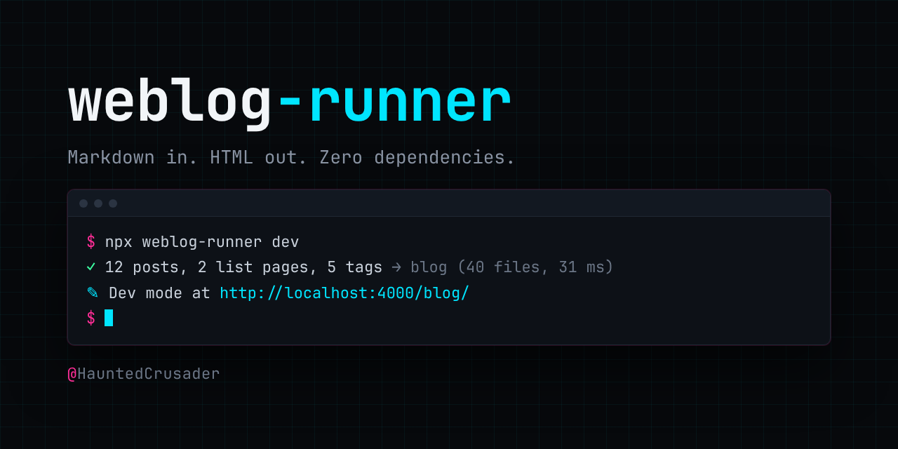
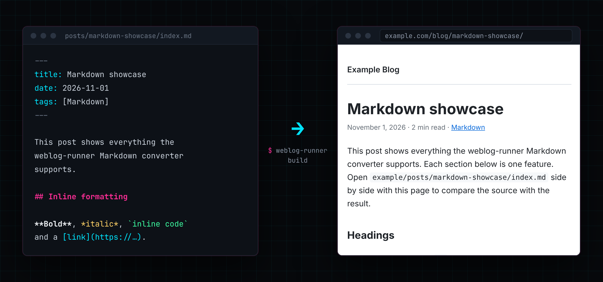

<p align="center">
  
</p>

<p align="center">
  <a href="https://www.npmjs.com/package/weblog-runner"></a>
  <a href="https://github.com/HauntedCrusader/weblog-runner/actions/workflows/test.yml"></a>
  = 20">
  
  <a href="LICENSE"></a>
</p>

**A tiny static blog generator.** You write posts in Markdown, it writes a
folder of plain HTML pages that any server can host. Templates are just
JavaScript functions, so the blog looks exactly like the rest of your site.

<p align="center">
  
</p>

## Why weblog-runner

- **Zero dependencies.** It ships with its own Markdown parser. Nothing to update or audit.
- **Templates are functions.** You use template strings that return HTML. There's no template language to learn.
- **Live reload while you write.** `dev` rebuilds on save and shows build errors right on the page.
- **Catches broken things.** Missing images, dead links and anchors are flagged, and `--strict` fails the build.
- **Batteries included.** RSS, sitemap, tags, pagination, reading time, and dates in your language.
- **Typed.** Your editor autocompletes the config and every field the templates receive.

## Install

```sh
npm install --save-dev weblog-runner
```

You need Node.js 20 or newer. Config and templates are ES modules, so your
`package.json` needs `"type": "module"` (or name the config `weblog.config.mjs`
and pass it with `--config`).

## Quick start

**1. Configure:** create `weblog.config.js` at the root of your site.

```js
import { post, list } from "./templates.js";

/** @type {import("weblog-runner").Config} */
export default {
  site: { title: "My Blog", url: "https://example.com/" },
  input: "posts",          // where your posts live
  output: "public/blog",   // where the HTML goes
  basePath: "blog/",       // where the blog lives on the site
  templates: { post, list },
};
```

**2. Template:** create `templates.js`. Each function returns a whole page.

```js
import { escapeHtml as e, href } from "weblog-runner";

const layout = (title, body) => `<!DOCTYPE html>
<html lang="en"><meta charset="utf-8"><title>${e(title)}</title>
<body>${body}</body></html>`;

/** @type {import("weblog-runner").PostTemplate} */
export const post = (post, ctx) =>
  layout(post.title, `<h1>${e(post.title)}</h1><p>${post.longDate}</p>${post.html}`);

/** @type {import("weblog-runner").ListTemplate} */
export const list = (page, ctx) =>
  layout(ctx.site.title, page.items
    .map((p) => `<h2><a href="${href(ctx, p.path)}">${e(p.title)}</a></h2>`)
    .join(""));
```

**3. Write and build:**

```sh
npx weblog-runner new "Hello world"   # creates posts/hello-world/index.md
npx weblog-runner dev                 # live preview at http://localhost:4000
npx weblog-runner build               # the final site, ready to publish
```

```
public/blog/
├── index.html              the post list (page 1)
├── page/2/index.html       more pages
├── hello-world/index.html  one folder per post
├── tag/<tag>/index.html    one page per tag (with a tag template)
├── feed.xml                RSS
└── sitemap.xml
```

New posts start as drafts. Remove `draft: true` when it's ready.

## Usage

### Commands

| Command | What it does |
|---|---|
| `weblog-runner new "Title"` | Creates `posts/<slug>/index.md` as a draft |
| `weblog-runner dev [--port 4000]` | Builds with drafts, serves the site and reloads on every save |
| `weblog-runner build` | Builds the blog to publish |
| `build --drafts` | Includes drafts (to review a build) |
| `build --strict` | Fails on warnings (broken image, link or anchor) |
| `--config <file>` | Uses another config file (default: `./weblog.config.js`) |

### Config

| Option | Default | What it is |
|---|---|---|
| `site.title` | *required* | The blog's name |
| `site.url` | *required* | The full site address, ending in `/` |
| `site.description` | `""` | Goes to the feed |
| `site.lang` | `"en"` | `<html lang>`, the feed and the date format (`"pt-BR"`, `"en-GB"`, `"es"`…) |
| `input` | *required* | The posts folder |
| `output` | *required* | Where to write the blog |
| `basePath` | `""` | Where the blog lives on the site, like `"blog/"` |
| `perPage` | `10` | Posts per list page |
| `rss`, `sitemap` | `true` | Write `feed.xml` and `sitemap.xml` |
| `markdown.html` | `true` | `false` escapes HTML written in posts |
| `root` | output − basePath | The site root that `dev` serves (so your CSS and images load) |
| `templates` | *required* | `{ post, list, tag? }` |

Folders are relative to the config file.

### Posts

Each post is a folder: the text goes in `index.md` and its images go right
next to it. Everything in the folder is copied along with the page.

```
posts/
├── tools-not-traps/
│   ├── index.md          uses 
│   ├── cover.jpg
│   └── photos/bench.jpg
└── hello-world/
    └── index.md
```

```markdown
---
title: Tools, not traps
date: 2026-11-18
tags: [Principles, Interfaces]
description: Optional. Defaults to the start of the first paragraph.
cover: cover.jpg
updated: 2026-12-01
slug: optional-custom-address
draft: true
---

The post, in **Markdown**.
```

Only `title` and `date` are required. The address comes from the folder
name, so `tools-not-traps/` becomes `/blog/tools-not-traps/`. A single
`tools-not-traps.md` file works too, for posts without images.

### Templates

| Function | Receives | Writes |
|---|---|---|
| `post(post, ctx)` | one post | `blog/<slug>/index.html` |
| `list(page, ctx)` | one page of posts | `blog/index.html`, `blog/page/2/index.html`… |
| `tag(group, ctx)` *(optional)* | a tag and its posts | `blog/tag/<slug>/index.html` |

Two rules:

1. **Links:** every `path` starts at the site root. Turn it into a link with
   `href(ctx, post.path)`, and the blog works in any folder, in `dev`, and
   even opened from disk.
2. **Escaping:** `title`, `description` and tags are plain text, so pass them
   through `escapeHtml`. `post.html` is already HTML.

<details>
<summary><b>All the fields</b></summary>

**`post`**

| Field | Example |
|---|---|
| `title`, `slug` | `"Tools, not traps"`, `"tools-not-traps"` |
| `date`, `updated` | `"2026-11-18"`, `"2026-12-01"` or `null` |
| `longDate`, `shortDate` | `"November 18, 2026"`, `"Nov 18, 2026"` (in `site.lang`) |
| `description` | plain text |
| `tags` | `["Principles", "Interfaces"]` |
| `cover`, `coverUrl` | `"blog/tools-not-traps/cover.jpg"`, the full URL (for `og:image`), or `null` |
| `html` | the converted body |
| `path`, `url` | `"blog/tools-not-traps/"`, the full URL |
| `previous`, `next` | `{ slug, title, path }` or `null` |
| `readingTime` | `3` (minutes) |
| `draft`, `file` | `false`, `"tools-not-traps/index.md"` |
| `frontmatter` | the whole frontmatter, for your own fields |

**`page`**: `number`, `total`, `items`, `previous`, `next`, `path`, `previousPath`, `nextPath`

**`group`**: `tag`, `slug`, `posts`, `path`

**`ctx`**: `site`, `path`, `root` (the way back to the site root, like `"../../"`)

</details>

**Autocomplete:** the `/** @type … */` comments above give you suggestions in
VS Code. Add `// @ts-check` at the top of the file to also get errors.

### Markdown

| You write | You get |
|---|---|
| `#` … `######` | headings, with an `id` for anchor links |
| `**bold**`, `*italic*`, `` `code` `` | `<strong>`, `<em>`, `<code>` |
| `[text](url)`, `` | links and images |
| `-`, `1.`, indented items | lists, nested as deep as you like |
| `> quote` | blockquotes (any block inside) |
| ```` ```js ```` | code blocks with `class="language-js"` |
| `\| a \| b \|` | tables, aligned with `align-left`, `align-center` and `align-right` classes |
| `---` | `<hr>` |
| `<kbd>`, `<details>`, `<figure>`… | raw HTML passes through |

Footnotes and task lists aren't supported.

### Warnings and cleanup

After each build, every image, link, anchor and cover is checked against the
generated pages and the site's files:

```
✓ 12 posts, 2 list pages, 5 tags → blog (40 files, 31 ms)
⚠ tools-not-traps/index.md: image not found: photos/anvil.jpg
⚠ hello-world/index.md: broken link: ../old-post/
```

Each build also deletes the pages the previous build made and this one
didn't, such as a renamed post or a draft. It only touches files it wrote
itself, which it tracks in `.weblog-runner.json`.

## Example

The repo has a complete example blog with a neutral style, dark mode, tags,
pagination, and a post that shows off every Markdown feature.

```sh
git clone https://github.com/HauntedCrusader/weblog-runner.git
cd weblog-runner
npm run example        # builds it into example/output/blog/
```

Open `example/output/blog/index.html` in the browser. Copy
[`example/templates.js`](example/templates.js) as a starting point for your
own blog.

## License

[MIT](LICENSE) © HauntedCrusader
